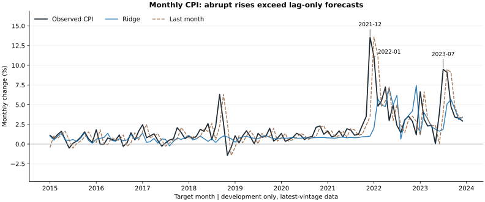
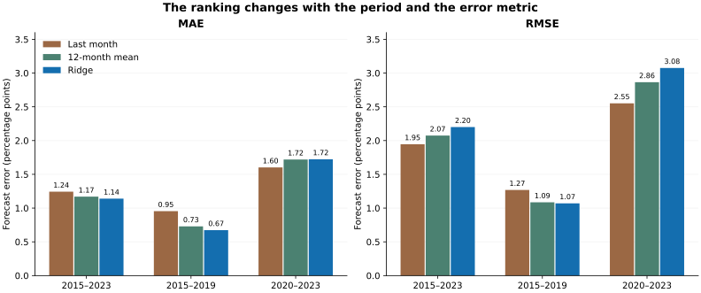

# Turkey Inflation Lab

Can historical monthly inflation help forecast Türkiye's next published monthly CPI change?

This project compares three simple benchmarks with a small Ridge model. The first intended use is an analyst's monthly economic brief; budgeting applications would require a separate cost basket and planning horizon.

## What the experiment shows

Ridge slightly improves average absolute error, but misses several large inflation rises. Three months account for **57% of its total squared forecast error**. That concentration matters more than a small average gain when large misses are costly.

Development evaluation: January 2015–December 2023, 108 paired months. Errors below are in percentage points.

| Method | MAE ↓ | RMSE ↓ |
|---|---:|---:|
| Last month | 1.2427 | **1.9463** |
| Same month last year | 1.5235 | 2.7079 |
| Trailing 12-month mean | 1.1692 | 2.0740 |
| Ridge, 12 monthly lags | **1.1397** | 2.2001 |

The ranking also changes by period: during 2020–2023, last-month persistence has lower MAE than Ridge (1.6027 versus 1.7227).

The evidence suggests that lagged CPI alone is insufficient for the largest moves in this sample. It does not identify their economic causes. Read the [research note](docs/RESEARCH-NOTE.md) for the error months, alternative explanations and the next research question.

## Try it

Open the Colab badge and choose **Runtime → Run all**. The [single notebook](notebooks/turkey_inflation_lab.ipynb) includes the frozen data, analysis code and reference results; no clone or separate CSV upload is needed. After the initial dependency installation, restart the session if requested and run all again.

Local checks and a Colab CPU run reproduced all 432 development predictions. [Reproduction instructions and environment details](docs/REPRODUCIBILITY.md) cover both the notebook and Python scripts.

## Explore the data and methods

- [CPI observations](data/published/research-v1/snapshot/cpi.csv) · [Predictions](data/published/research-v1/results/predictions.csv) · [Period metrics](data/published/research-v1/results/metrics.csv)
- [Data dictionary](docs/CSV-SOZLUGU.md) · [Ridge design](docs/DENEY-002.md) · [Data limitations](docs/VERI.md)
- [Product direction](docs/VIZYON.md) · [Project ownership and AI assistance](docs/CONTRIBUTIONS.md)

This is latest-vintage pseudo-out-of-sample research: historical release times and first-release vintages are incomplete. The January 2024–September 2026 final holdout remains unscored. The findings do not establish live forecasting performance or a validated business integration.

## License and source

Original code and documentation: [MIT](LICENSE). CPI data and its reproduction in outputs have [separate agency terms](DATA-NOTICE.md), including TCMB's written-permission requirement for commercial use. Source: TÜİK via TCMB; snapshot retrieved 24 October 2026.

---

**Author:** [Mustafa YÖRÜK](https://github.com/mustafayoruk)  
*Statistics Student @ Hacettepe University*
